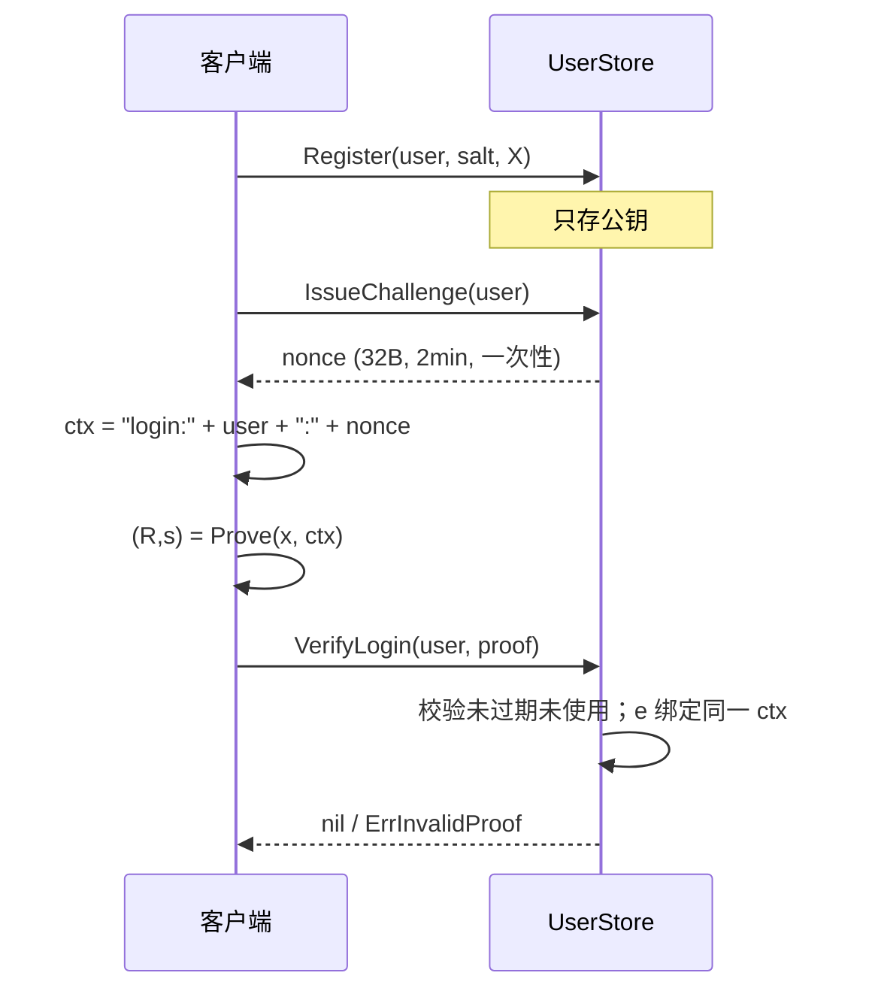

# ZK 登录与权限证明 — 实现方案

本文描述 `auth/zk` **当前代码**的设计与实现，对应可运行示例 `go run .`（在 `auth` 模块下为 `go run ./zk`）。

本包是 **教学/原型级** 零知识组件：服务器不保存明文密码与权限明文，只验证证明。尚未接入 `auth` 服务的 HTTP/gRPC 主路径，也未做第三方审计。

---

## 1. 目标与非目标

### 1.1 目标

| 场景 | 证明者持有 | 验证者看到 | 验证者得到的结论 |
|------|------------|------------|------------------|
| 登录 | 由密码派生的私钥 \(x\) | 公钥 \(X=xG\)、Schnorr 证明、一次性 nonce | 证明者知道与公钥对应的 \(x\)（因而知道密码） |
| 权限门限 | 权限值 \(v\)、盲因子 \(r\) | Pedersen 承诺 \(C\)、差值承诺 \(D\)、64 位 bit 证明 | \(v \ge T\)，且不知道 \(v\) |

### 1.2 非目标

- 不替代 JWT / 会话；登录成功后如何发 token 由业务层决定。
- 不是 Bulletproofs / Groth16 / Plonk；权限范围证明是 **按位 Chaum–Pedersen OR**，证明体积大、仅支持 \(0 \le v,T < 2^{64}\)。
- 密码派生不是 argon2/scrypt（当前为域分隔 SHA-256 → 标量），**不能直接上生产**。
- 不把私钥、密码、权限明文写入日志。

### 1.3 信任模型

- 椭圆曲线：NIST P-256，群阶 \(N\)，基域素数 \(P\)，基点 \(G\)。
- Pedersen 第二生成元 \(H\)：hash-to-curve，实现上假定 \(\mathrm{dlog}_G(H)\) 未知。
- 验证者诚实执行协议；主动攻击者可重放证明，因此登录绑定 **用户名 + 一次性 nonce**。
- 权限证明不绑定会话；若接入业务，应把 `request_id` / 用户公钥一并纳入 Fiat–Shamir 上下文（当前未做）。

---


## 2. 目录与职责

```
auth/zk/
├── main.go                 # 注册/登录/权限门限可运行示例
├── implementation.md       # 本文件
├── crypto/                 # 曲线运算、哈希到标量/基域
│   ├── curve.go
│   ├── hash.go
│   └── hash_test.go
├── schnorr/                # 密码 → 密钥、Schnorr NIZK
├── pedersen/               # C = vG + rH
├── range/                  # 证明承诺明文 ∈ {0,1}（包名 rangepf）
├── permission/             # 证明 v ≥ T
└── auth/                   # 内存用户库 + 登录/权限门面
```

依赖方向（禁止反向）：

```
main → auth → schnorr, permission
permission → pedersen, range, crypto
range → pedersen, crypto
schnorr → crypto
pedersen → crypto
```

`range` 目录因 Go 关键字不能以 `range` 为包名，源码包名为 `rangepf`，导入：

```go
rangepf "github.com/Crows-Storm/Axis/auth/zk/range"
```

---

## 3. 密码学原语（`crypto`）

### 3.1 标量与点

| 函数 | 含义 | 注意 |
|------|------|------|
| `RandomScalar` | 均匀取 \([1, N-1]\) | 拒绝 0 |
| `Reduce` | \(\cdot \bmod N\) | 点乘前必须约化 |
| `MulBase(k)` | \(kG\) | 32 字节大端，避免 `Bytes()` 去前导零导致实现差异 |
| `Mul(k, P)` | \(kP\) | 同上 |
| `Add` | 曲线点加 | `elliptic.P256().Add` |
| `Neg` / `Sub` | 点负元 / 点减 | **Y 坐标在基域 \(P\) 上取负**，不是群阶 \(N\) |

点负元错误曾导致 `C - T\cdot G` 算错，权限验证恒失败。实现：

\[
-(x,y) = (x,\; -y \bmod P)
\]

### 3.2 `HashToScalar`（Fiat–Shamir / KDF）

1. 对 `label` 与各 `parts` 做 **8 字节大端长度前缀** 拼接，防拼接歧义。
2. SHA-256 得 32 字节，再拼 `SHA256(digest ‖ 0x01)` 扩到 64 字节。
3. 解释为整数后 \(\bmod N\)。

必须写成 `x.Mod(x, N)`。写成 `Mod(N, N)` 会恒为 0：挑战 \(e=0\) 时 Schnorr 退化为 \(s=r\)，**任意公钥都能过验证**。

### 3.3 `HashToField`

只用于 hash-to-curve 的 \(x\) 候选，模基域 \(P\)，不是模 \(N\)。

---

## 4. 登录：Schnorr 知识证明

### 4.1 密钥派生

```text
x = HashToScalar("zk-LOGIN-KDF-v1", salt, password)
若 x = 0 则 x = 1
X = x · G
```

服务器 `Register` 只存 `username, salt, PublicX, PublicY`。密码与 \(x\) 留在客户端。

生产应换成 argon2id 等内存困难 KDF，再映射到 \(\mathbb{Z}_N\)。

### 4.2 Schnorr NIZK

证明语句：\(\exists x:\; X = xG\)。

**Prove**（`schnorr.Prove`）

1. \(r \leftarrow \mathbb{Z}_N^\times\)，\(R = rG\)
2. \(e = H(\texttt{Schnorr-NIZK-v1},\; X_{\mathrm{bytes}},\; R_{\mathrm{bytes}},\; \mathrm{ctx})\)
3. \(s = r + e\cdot x \pmod N\)
4. 输出 \((R, s)\)

**Verify**（`schnorr.Verify`）

1. 检查 \(R,X\) 在曲线上
2. 同样计算 \(e\)
3. 检查 \(sG \stackrel{?}{=} R + eX\)

点序列化为非压缩 `0x04 ‖ X‖Y`，各 32 字节，保证哈希输入定长。

### 4.3 与服务器绑定（`auth.UserStore`）



`ctx` 必须与服务端 `buildCtx` 完全一致。换 nonce、换用户名或换密码派生出的 \(X\) 都会失败。

Nonce 在验证时立即 `used=true`（无论证明对错），防止同一挑战上穷举。新登录必须重新 `IssueChallenge`。

`ClientLogin`：从 `store.Salt` 取盐（演示用；真实系统盐可随挑战下发，盐不是秘密）。

---

## 5. Pedersen 承诺（`pedersen`）

\[
C = vG + rH
\]

- 隐藏：不知 \(r\) 时 \(C\) 与均匀随机点不可区分（DLOG 假设）。
- 绑定：不知 \(\mathrm{dlog}_G(H)\) 时无法打开成两个不同 \(v\)。
- 加法同态：\(C(v_1,r_1)+C(v_2,r_2)=C(v_1+v_2,r_1+r_2)\)。

\(H\) 生成：对 seed `"Pedersen-H-v1"` 递增 counter，把哈希结果当 \(x\) 坐标，P-256 上 \(p\equiv 3\pmod 4\) 用 \((p+1)/4\) 开方，直到点在曲线上。

**禁止** \(H = kG\) 且实现者知道 \(k\)，否则绑定被破坏。

---

## 6. 权限门限：\(v \ge T\)

公开：门限 \(T\)。  
私有：\(v,r\)。  
公开承诺：\(C = vG + rH\)。

令 \(\delta = v - T\)。若 \(v \ge T\) 则 \(\delta \ge 0\)，可写成 64 位：

\[
\delta = \sum_{i=0}^{63} b_i 2^i,\quad b_i\in\{0,1\}
\]

### 6.1 证明结构（`permission.PermissionProof`）

| 字段 | 内容 |
|------|------|
| `Commitment` \(C\) | \(vG + rH\) |
| `Delta` \(D\) | \(\delta G + rH\)（同一 \(r\)） |
| `BitCommitments` \(C_i\) | \(C_i = b_i G + r_i H\) |
| `RangeBits` | 每个 \(C_i\) 的 bit OR 证明 |

关系：

\[
D = C - T\cdot G
\]

因为 \(C - TG = (v-T)G + rH = D\)。验证端只做点运算，无需 \(v\)。

### 6.2 盲因子分割

若各 \(r_i\) 独立，则 \(\sum 2^i C_i = \delta G + (\sum 2^i r_i)H\)，一般 **不等于** \(D\)（\(D\) 的盲因子是 \(r\)）。

因此构造 \(r_0,\ldots,r_{63}\) 满足

\[
\sum_{i=0}^{63} 2^i r_i \equiv r \pmod N
\]

`splitBlind`：前 63 个随机，最后一个

\[
r_{63} = \bigl(r - \sum_{i<63} 2^i r_i\bigr)\cdot (2^{63})^{-1} \pmod N
\]

\(N\) 为素数，\(2^{63}\) 可逆。于是

\[
\sum_i 2^i C_i = D
\]

### 6.3 验证步骤（`VerifyPermissionAbove`）

1. \(\lvert\mathrm{bits}\rvert=\lvert C_i\rvert=64\)。
2. \(D \stackrel{?}{=} C - TG\)。
3. 每个 `BitProof.C` 与 `BitCommitments[i]` 坐标一致，且 `VerifyBit` 通过。
4. \(\sum 2^i C_i \stackrel{?}{=} D\)。

\(v < T\) 时 `ProvePermissionAbove` **直接返回错误**，不生成可验证假证明（诚实证明者语义）。验证端仍必须跑完整校验，防止恶意拼装。

用错误 \(T'\) 去验证别人对 \(T\) 生成的证明会在第 2 步失败。

---

## 7. Bit 证明：Chaum–Pedersen OR（`range`）

语句：\(C = bG + rH\) 且 \(b\in\{0,1\}\)，等价于：

- 分支 0：\(C = rH\)（即 \(C\) 是 \(H\) 的倍数）
- 分支 1：\(C - G = rH\)

### 7.1 模拟 OR

真分支用真实 \(k,r\)；假分支预选 \((e_{\mathrm{fake}}, z_{\mathrm{fake}})\)。

**当 \(b=0\)**

- \(T_0 = kH\)
- \(T_1 = z_{\mathrm{fake}}H - e_{\mathrm{fake}}(C-G)\)
- \(e = H(\texttt{RangeBit-OR-v1}, T_0, T_1, C)\)
- \(e_1 = e_{\mathrm{fake}},\; e_0 = e - e_1\)
- \(z_0 = k + e_0 r,\; z_1 = z_{\mathrm{fake}}\)

**当 \(b=1\)** 对称：真分支做 \(T_1=kH\)，假分支模拟分支 0。

### 7.2 验证

\[
e_0+e_1 = H(T_0,T_1,C)
\]
\[
T_0 = z_0 H - e_0 C
\]
\[
T_1 = z_1 H - e_1 (C-G)
\]

证明里必须带原承诺 \(C\)（`BitProof.C`），否则验证方程无法闭合。

---

## 8. 示例程序（`query_main_test.go`）

```text
1. 用密码派生 x，注册公钥
2. 正确密码：IssueChallenge → Prove → VerifyLogin → true
3. 错误密码：新 challenge + 错误派生密钥 → false
4. v=850, T=500 → ProvePermissionAbove + Verify → true
5. v=100, T=500 → Prove 返回 error
```

运行（模块根为 `auth/`）：

```bash
cd auth
go run ./zk
go test ./zk/...
```

---

## 9. 对外 API 一览

### `auth.UserStore`

| 方法 | 说明 |
|------|------|
| `Register(user, salt, pubX, pubY)` | 存公钥；用户已存在 → `ErrUserExists` |
| `Salt(user)` | 演示：客户端取盐 |
| `IssueChallenge(user)` | 32 字节 nonce，2 分钟，覆盖旧挑战 |
| `VerifyLogin(user, proof)` | 校验 Schnorr；失败 `ErrInvalidProof` / `ErrNonceInvalid` |

### `auth` 门面

| 函数 | 转发 |
|------|------|
| `ProvePermissionAbove(v,T,r)` | `permission.ProvePermissionAbove` |
| `VerifyPermissionAbove(proof,T)` | `permission.VerifyPermissionAbove` |

证明者需要自己保管 \(r\)；若要把 \(C\) 存库，注册权限时应同时保存 \(C\) 的坐标，验证时比对 `proof.Commitment` 是否与库中一致（**当前示例未持久化 C**）。

---

## 10. 接入业务时的建议步骤（仍只在 zk 语义内）

当前 `auth/app/.../zero_knowledge.go` 尚未调用本包。若以后接入，建议：

1. 注册接口：客户端提交 salt + 公钥；服务端写入用户表，**禁止**收密码哈希以外的明文密码（本方案连哈希都不存）。
2. 登录：`IssueChallenge` → 客户端 `Prove` → `VerifyLogin` → 再发 JWT。
3. 权限：用户持有 \((v,r)\)，或从安全硬件取出；服务端存 \(C\) 与策略 \(T\)；请求时提交 `PermissionProof`，先核对 \(C\) 再 `VerifyPermissionAbove`。
4. 把 `ctx` / Fiat–Shamir 输入扩展为：`user ‖ C ‖ T ‖ request_id`，避免证明跨请求重放。

---

## 11. 明确限制

| 项 | 现状 |
|----|------|
| 曲线 | P-256，非 zk-friendly 曲线 |
| 密码 KDF | SHA-256 标量，不抗专用破解 |
| 范围证明 | 64 个 OR 证明，带宽与 CPU 远高于 Bulletproofs |
| 负权限 | 拒绝 `v<0` 或 `T<0` |
| \(H\) 的 dlog | 依赖 hash-to-curve 实现正确；未用 RFC 9380 |
| 侧信道 | `big.Int` 非恒定时间 |
| 并发 | `UserStore` 有锁；证明生成无共享可变状态 |
| 审计 | 无 |

上线前应替换 KDF、范围证明（Bulletproofs 或电路），并对点是否为无穷远、子群、规范化编码做完整检查。

---

## 12. 曾修复的缺陷（实现约束）

1. `HashToScalar` 必须 `Mod(hash, N)`，不能 `Mod(N, N)`。
2. 点减必须用基域负 \(Y\)。
3. Bit 证明必须携带 \(C\)，真分支 \(z=k+er\)。
4. \(\sum 2^i r_i \equiv r \pmod N\)，否则同态求和对不上 \(D\)。
5. `ProvePermissionAbove` 放在 `auth` 包供示例调用；`ClientLogin` 通过 `Salt` 取盐。
